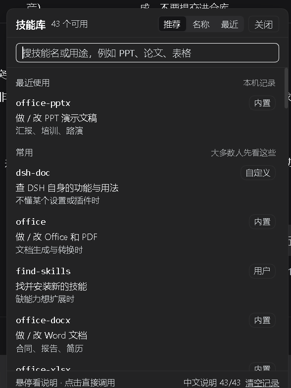
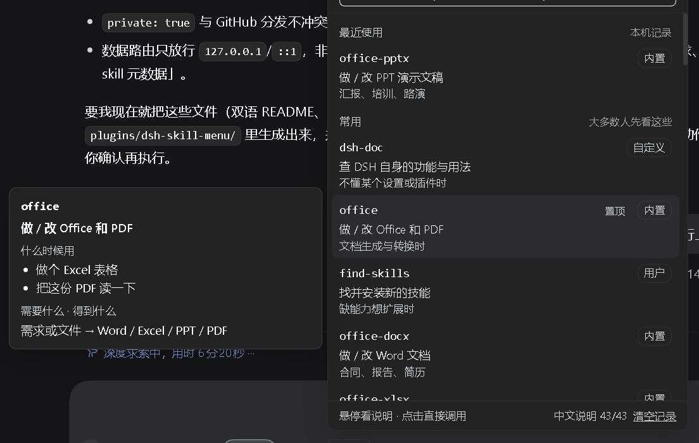
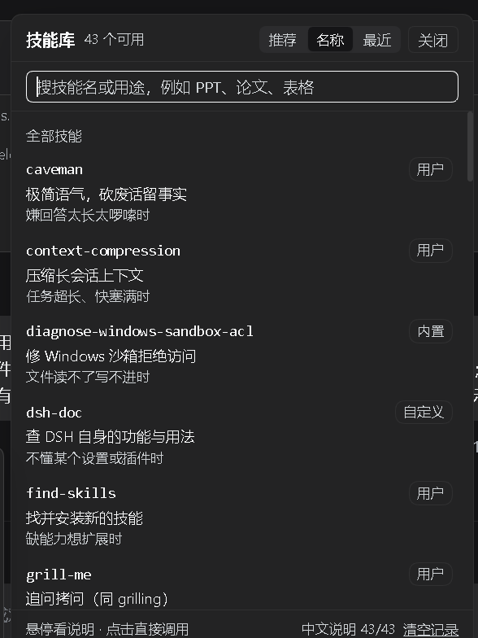
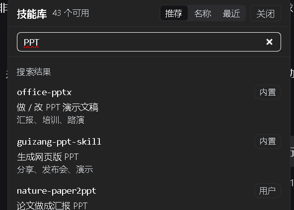

# dsh-skill-menu · Skill menu

[中文](README.md)

DeepSeek Harness (DSH) puts a row of small buttons under the composer. This plugin adds a button labelled `skill` to that row. Clicking it opens a catalogue of skills grouped by purpose and ordered by what people actually use; hovering a row shows a four-part note; clicking a row sends that skill into the current conversation.


The plugin is a DSH bundle: one half runs in the host process and fetches the data, the other runs in the page and draws the panel.

## The problem it solves

A DSH install usually carries dozens of skills — 43 are invocable on this machine, 10 bundled with the release and the rest from the user directory, project directories and third-party plugins. Using the `/` menu or recalling names runs into three concrete problems:

- Names and descriptions are in English. `dsh-doc` and `find-skills` are guessable; `grill-me`, `context-compression` and `nature-paper-xray` are not.
- Frequently used skills sit next to ones touched once a year. The default order is alphabetical, which buries `office` and `dsh-doc` in the middle.
- To use a skill you first have to remember its name and type it into the composer.

The plugin puts the catalogue next to the composer, organises it by when you would reach for it, and explains each entry in plain Chinese.

## Interface

### Trigger button

The button sits in the composer tool row, right of the emoji picker and left of 优化. It is registered in the `conversation.input.left` slot (`id: skill-menu`, `order: 6`). Clicking it opens the panel; clicking again closes it.

The button is the text `skill` rather than an icon: a sparkle icon was tried first and was nearly indistinguishable from the 优化 button next to it.

### Panel



The panel is registered in `conversation.input.overlay`, floats above the composer, and has four parts:

| Area | Content |
| --- | --- |
| Header | `技能库`, `<N> available`, three sort modes (recommended / name / recent), close button |
| Search box | filters as you type, ✕ clears |
| List | sections per the active sort; three lines plus a source tag per row |
| Footer | hint, Chinese-description coverage (`中文说明 43/43`), `清空记录` when there is history |

Each row has three lines: the skill name, what it does, and when to use it. The tag on the right says where it came from: bundled / custom / user / project / runtime / skills-manager.

### Hover note



Resting on a row for about 0.28 s opens a note at the left of the panel. It has four parts, ending with what the skill needs and returns:

```
office
create / edit Office files and PDFs
when to use
  · build a spreadsheet
  · read this PDF
needs · returns
  a request or a file → Word / Excel / PPT / PDF
```

The note flips to the right side when it would overflow, and disappears 0.14 s after the pointer leaves. A `置顶` (pin) button appears inside the hovered row.

### Sorting and search



Choosing `名称` turns the list into a flat "all skills" view in alphabetical order. `最近` orders by how often each skill was clicked on this machine.



Typing `PPT` switches to search results and returns four rows: `office-pptx`, `guizang-ppt-skill`, `nature-paper2ppt`, `nature-image2ppt`. The search matches the skill name, the Chinese purpose and the category label, so `论文`, `表格` or `开发排查` work too.

## How it behaves

### What the list contains

Data comes from the DSH `skills` service rather than from scanning directories. The list means "skills this session can invoke":

- The request carries `sessionId`; the host resolves the session's Agent and uses the Agent as the scope. That choice decides the count: the global scope alone returns 12 rows, the session scope returns 43.
- Rows with `userInvocable: false` are hidden, since they cannot be invoked anyway.
- Skills contributed by the `dsh-skills-manager` plugin are recognised separately (`provider === 'dsh-skills-manager-external'`), plus a scan of `SKILL.md` files under `~/.dsh/skills-manager`; those rows are tagged `技能管家`.

### Ordering and sections

The default `推荐` mode orders pinned → recent → common → six categories. The categories are docs & office, writing, research, design, dev & diagnostics, and other.

"Common" is not usage-based: it uses weights built into the plugin. Skills with weight ≥ 70 fill the top 10, and the section carries the hint "most people start here". A fresh install therefore has a sensible first screen without waiting for usage history. Click counts drive the "recent" section instead.

The chosen mode is stored in `localStorage` and reused next time.

### Chinese notes

`client.js` holds a 43-entry `CATALOG`, each entry with five fields:

| Field | Purpose |
| --- | --- |
| `short` | one-line "what it does", shown in every row |
| `scene` | one-line "when to use it", the third line of a row |
| `when[]` | 2–3 trigger cases in the hover note |
| `io` | the "needs · returns" part of the hover note |
| `cat` / `weight` | category and common-list weight |

Skills missing from the table fall back to their own `description`; English ones are marked as untranslated rather than given a made-up translation. The footer coverage is simply how many rows have an entry.

### What a click does

Clicking a row (or pressing Enter on a selected one):

1. closes the panel;
2. writes `使用 skill「<name>」` into the composer, keeping any existing draft on the next line;
3. submits it when `AUTO_SEND` is `true`;
4. the agent receives the message and invokes that skill through the `skill` tool.

Step 4 happens outside the plugin. The plugin only makes "which skill" explicit in the message; everything after that matches asking for the skill in conversation. Set `AUTO_SEND` to `false` to fill the composer without sending.

### Local memory

Three `localStorage` keys, all local:

| Key | Content |
| --- | --- |
| `dshsm.usage` | click count per skill |
| `dshsm.pins` | pinned skills, at most 5 |
| `dshsm.sort` | last chosen sort mode |

`清空记录` in the footer clears the counts; pins must be removed one by one. Reads and writes are wrapped in `try/catch`, so a browser with storage disabled degrades to in-memory state.

### Keyboard

`↑` / `↓` move the selection, `Enter` runs it, `Esc` closes the panel. Clicking outside also closes it.

## How it works

There are two halves: `index.js` on the host and `client.js` in the page, both installed into the DSH loader through `cordis.patch.yml`.

```
page                            host process                DSH services
─────────────────────────────────────────────────────────────────────
skill button (input.left)
  │ click
  ▼
panel (input.overlay, portal to body)
  │ GET /dsh-skill-menu/list?sessionId=…
  ▼
                        index.js route
                          │ checks: loopback only, GET only
                          │ resolves: sessionId → Agent
                          ▼
                                                    skills.list({ scope: agent })
                          ◄─────────────────────────────────────┘
                          │ normalise fields, sort by name, tag manager rows
  ◄───────────────────────┘
  │ client: sections, search, sorting, rendering
  │ row click → setDraft + submit
  ▼
agent receives 使用 skill「<name>」 → invokes the skill tool
```

**Loading.** At startup DSH reads the `insert` block in `cordis.patch.yml` and adds the package to its loader. The host `apply(ctx)` registers `/dsh-skill-menu/list`; the client `apply(ctx)` registers one component in `conversation.input.left` and one in `conversation.input.overlay`, and injects a stylesheet. Styles and listeners are tied to `ctx.effect` cleanup, so disabling the plugin or hot-reloading removes them.

**Fetching.** The panel requests the list when it opens and caches it for the page session; reopening fetches again. The host resolves `sessionId` to an Agent by trying the value itself, then the `session-<id>` prefix, then a suffix match. With an Agent it queries the catalogue in that scope, otherwise it falls back to the global list. Each returned row carries name, English description, source, provider and two invocation flags.

**Rendering.** Sections, search matching and sorting all happen in the page; the host only supplies a clean list. The panel and the note are rendered with `ReactDOM.createPortal` into `document.body`, because the composer card has `transform` and `overflow: hidden` and would clip them.

**Clicking.** Row clicks are handled by a capture-phase listener on `window` that dispatches on `data-dshsm-row` and `data-dshsm-action`; React's `onPointerDown` is a fallback and the two paths de-duplicate over 400 ms. This is needed because the host intercepts native clicks on overlays at `document` level, so React synthetic events never arrive.

**Failures.** An unreachable route shows an error row with a `重试` button; non-loopback requests get 403, non-GET 405, and a missing `skills` service 503. A panel stuck on "loading…" usually means the DSH web port changed or the plugin is disabled.

## Install

Requires a working DSH; methods B and C need `git`.

**A. Release zip + Plugins UI**

```bash
mkdir -p "$HOME/dsh-plugins"
curl -L -o /tmp/dsh-skill-menu.zip \
  https://github.com/qiejianchuangyi/dsh-skill-menu/releases/latest/download/dsh-skill-menu.zip
unzip -o /tmp/dsh-skill-menu.zip -d "$HOME/dsh-plugins/"
```

Windows PowerShell:

```powershell
Invoke-WebRequest -Uri https://github.com/qiejianchuangyi/dsh-skill-menu/releases/latest/download/dsh-skill-menu.zip -OutFile "$env:TEMP\dsh-skill-menu.zip"
Expand-Archive -Path "$env:TEMP\dsh-skill-menu.zip" -DestinationPath "$HOME\dsh-plugins" -Force
```

Then in DSH open **Plugins → Add plugin**, select `~/dsh-plugins/dsh-skill-menu`, and reload the page (`Ctrl+R`).

**B. git clone + Plugins UI**

```bash
git clone https://github.com/qiejianchuangyi/dsh-skill-menu.git "$HOME/dsh-plugins/dsh-skill-menu"
```

**C. Command line**

```bash
git clone https://github.com/qiejianchuangyi/dsh-skill-menu.git "$HOME/dsh-plugins/dsh-skill-menu"
```

Ask the DSH agent to install that directory, which maps to `plugin_manager` `install_bundle` with the absolute path as `target`. After `application: applied`, toggle the plugin entry off and on, then reload.

All three methods install the same code. The plugin page should then show "技能菜单 / 在输入框左侧加一个 skill 按钮…".

## Usage

1. The `skill` button appears in the composer tool row.
2. Open the panel; the first screen is "common", the 10 skills most people reach for.
3. Hover a row for 0.3 s and read the four-part note to check it is the right skill.
4. Click the row; `使用 skill「<name>」` is sent and the agent starts working from that skill's instructions.

## Configuration

Constants at the top of `client.js`; a reload applies them:

| Constant | Default | Effect |
| --- | --- | --- |
| `AUTO_SEND` | `true` | send on click; `false` only fills the composer |
| `PANEL_W` / `TIP_W` | `380` / `330` | panel and note width in CSS px, shrinks on narrow screens |
| `COMMON_MIN_WEIGHT` | `70` | weight threshold for the "common" section |
| `COMMON_LIMIT` | `10` | max rows in "common" |
| `RECENT_LIMIT` | `5` | max rows in "recent" |
| `PIN_LIMIT` | `5` | max pins |
| `TIP_SHOW_DELAY` / `TIP_HIDE_DELAY` | `280` / `140` | hover show and hide delays in ms |

## Compatibility and limits

- The data route `/dsh-skill-menu/list` accepts loopback requests only (`127.0.0.1`, `::1`) and only GET; anything else gets 403. No list data leaves the machine.
- UI text is Chinese by design; `locale/*.json` only provides the Plugins-page title and description. Changing the UI language means editing `client.js`.
- The Chinese notes are a built-in table. Newly installed skills have no note until one is added to `CATALOG`; until then they show their English description.
- Usage counts, pins and sort preference live in browser `localStorage` and reset with the profile.
- The list is fetched when the panel opens; after adding or removing skills just reopen the panel, no DSH restart needed.
- Read-only: the plugin never opens or modifies skill files.

## Development

```bash
node --check index.js             # host entry syntax
node --check client.js            # client bundle syntax
node --test tests/host.test.mjs   # 5 cases: sorting, scope fallback, missing service, 405, non-loopback 403
node tests/client-smoke.mjs       # slot registrations and panel structure
```

Two GitHub Actions workflows ship with the repo: `ci.yml` runs those checks on push and PR; `release.yml` builds the zip with `git archive` and publishes a Release whenever a `v*` tag is pushed.

Editing `client.js` or `index.js` only needs a page reload; changes to `cordis.patch.yml` or the package name require reinstalling the plugin.

## License

[MIT](LICENSE)