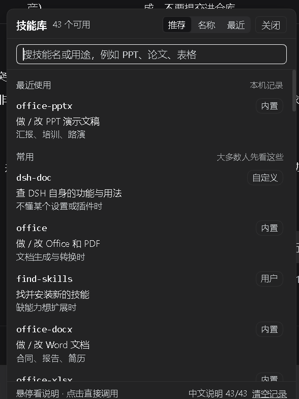
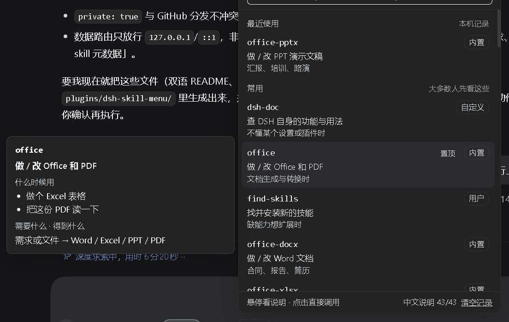
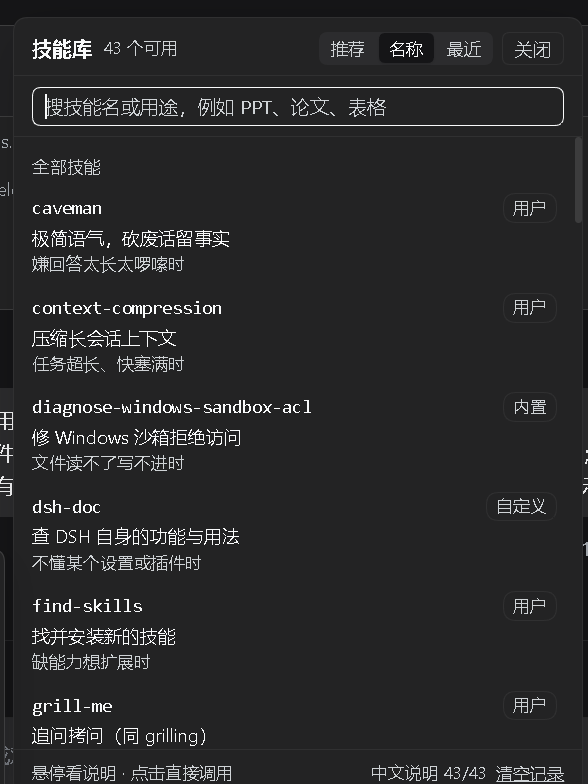
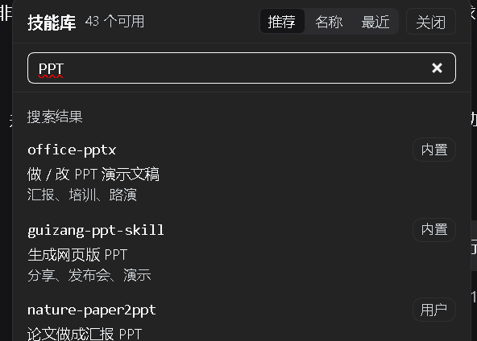

# dsh-skill-menu · 技能菜单

[English](README.en.md)

DeepSeek Harness（DSH）的对话输入框下面有一排小按钮，这个插件在它左边加了一个写着 `skill` 的按钮。点开是一个按用途分好类、按使用频率排好序的技能库；鼠标停在某一行，会看到四段中文说明；点一下，这个 skill 就被送进当前对话。


插件本身是 DSH 的一个 bundle：一半代码跑在宿主进程里负责取数据，一半跑在页面里负责画界面。

## 它解决什么问题

DSH 装好的机器通常有几十个 skill。这台机器实测可调用 43 个，其中 10 个随发行版内置，其余来自用户目录、项目目录和第三方插件。用 `/` 菜单或者记名字，会有三个具体麻烦：

- 名字和说明都是英文，看名字猜不出用途。`dsh-doc`、`find-skills` 还好，`grill-me`、`context-compression`、`nature-paper-xray` 不看说明没法判断。
- 常用的和一两年用一次的混在一起。默认顺序按名字排，最常点的 `office`、`dsh-doc` 跑到列表中间。
- 想用某个 skill 时，得先想清楚它叫什么，再去输入框里敲出来。

这个插件把技能库放在输入框旁边，按「什么时候用得上」组织，用中文说清楚每个 skill 干什么。

## 界面

### 入口按钮

按钮在输入框工具栏里，位置是表情包按钮右侧、`优化` 左侧，注册在 `conversation.input.left` 槽位（`id: skill-menu`，`order: 6`）。点一下打开面板，再点一下关闭。

按钮用文字 `skill`，不用图标：一开始试过火花图标，和右边的 `优化` 几乎一样，靠图标区分不出来。

### 面板



面板注册在 `conversation.input.overlay` 槽位，浮在输入框上方，从上到下四块：

| 区域 | 内容 |
| --- | --- |
| 标题行 | `技能库`、`N 个可用`、三档排序（推荐 / 名称 / 最近）、`关闭` |
| 搜索框 | 输入即过滤，右侧 ✕ 清空 |
| 列表 | 按当前排序分区，每行三层文案加右侧来源标签 |
| 页脚 | 操作提示、中文说明覆盖率（`中文说明 43/43`）、有记录时显示 `清空记录` |

每行三层：第一行 skill 名，第二行是这个 skill 做什么，第三行是什么时候用。右侧标签说明它从哪来：`内置` / `自定义` / `用户` / `项目` / `运行时` / `技能管家`。

### 悬停说明



鼠标停在一行上约 0.28 秒，面板左侧浮出说明框。内容分四段，最后一段是「需要什么 · 得到什么」：

```
office
做 / 改 Office 和 PDF
什么时候用
  · 做个 Excel 表格
  · 把这份 PDF 读一下
需要什么 · 得到什么
  需求或文件 → Word / Excel / PPT / PDF
```

面板放不下时说明框翻到右侧；鼠标移开 0.14 秒后消失。悬停的同一行里会出现 `置顶` 按钮。

### 排序与搜索



点标题行的 `名称`，列表变成扁平的「全部技能」，按字母序排。`最近` 档按本机使用次数从多到少。



在搜索框输入 `PPT`，列表切换成「搜索结果」，命中 4 条：`office-pptx`、`guizang-ppt-skill`、`nature-paper2ppt`、`nature-image2ppt`。搜索同时匹配 skill 名、中文用途和分类名，所以搜「论文」「表格」「开发排查」也能出结果。

## 功能细节

### 列表里有什么

数据来自 DSH 的 `skills` 服务，不是扫目录。列表口径是「当前会话能调用的 skill」：

- 请求带上 `sessionId`，宿主侧据此找到会话对应的 Agent，用 Agent 作为作用域去查目录。这一步决定数量：只查全局层会得到 12 条，按会话查是 43 条。
- `userInvocable: false` 的条目不显示，因为点了也调不起来。
- `dsh-skills-manager` 插件提供的外部技能单独识别（`provider === 'dsh-skills-manager-external'`），同时补扫 `~/.dsh/skills-manager` 下的 `SKILL.md`；这类行标 `技能管家`。

### 排序与分区

`推荐` 是默认档，顺序是：置顶 → 最近使用 → 常用 → 六个分类。六个分类是文档办公、写作表达、研究检索、设计排版、开发排查、其他。

「常用」不是按使用次数算，而是插件内置的权重：权重 ≥ 70 的 skill 取前 10 个，分区标题旁写「大多数人先看这些」。这样新装机器第一次打开就有合理的首屏，不用等积累使用记录。使用次数另外驱动「最近使用」区。

三档排序的选择存在 `localStorage`，下次打开沿用。

### 中文说明

`client.js` 里有一份 43 条的 `CATALOG`，每条五个字段：

| 字段 | 作用 |
| --- | --- |
| `short` | 一句话「做什么」，显示在每一行 |
| `scene` | 一句话「什么时候用」，显示在行内第三行 |
| `when[]` | 悬停说明里的触发场景，2–3 条 |
| `io` | 悬停说明的「需要什么 · 得到什么」 |
| `cat` / `weight` | 分类与常用权重 |

不在表里的 skill 回退到它自带的 `description`，英文的会在末尾标注「暂未收录中文说明」，不编假翻译。页脚的覆盖率就是表里有几条、列表里有几条。

### 点击之后发生了什么

点一行（或选中后按回车）：

1. 面板收起；
2. 输入框写入 `使用 skill「<name>」`，如果原本有草稿，草稿保留在下一行；
3. `AUTO_SEND` 为 `true` 时立即提交；
4. Agent 收到这条消息，调用 `skill` 工具加载同名 skill。

第 4 步不在插件里完成。插件只负责把「用哪个 skill」这件事明确写进消息，剩下的和你在对话里自己说「用 xxx skill」完全一样。想先看一眼再发，把 `AUTO_SEND` 改成 `false`。

### 本机记忆

三个 `localStorage` 键，都是本机的，不上传：

| 键 | 内容 |
| --- | --- |
| `dshsm.usage` | 每个 skill 被点过几次 |
| `dshsm.pins` | 置顶列表，最多 5 个 |
| `dshsm.sort` | 上次用的排序档位 |

页脚的 `清空记录` 清掉使用次数，置顶要手动取消。读写都包在 `try/catch` 里，浏览器禁用存储时降级成只在内存里记，不影响使用。

### 键盘

`↑` `↓` 选行，`Enter` 执行选中的行，`Esc` 关闭面板。点击面板外任意位置也会关闭。

## 运行逻辑

插件分两半：宿主侧的 `index.js`，页面侧的 `client.js`（通过 `cordis.patch.yml` 一起装进 DSH 的载入器）。

```
页面                          宿主进程                     DSH 服务
─────────────────────────────────────────────────────────────────
skill 按钮（input.left）
  │ 点击
  ▼
面板（input.overlay，portal 到 body）
  │ GET /dsh-skill-menu/list?sessionId=…
  ▼
                        index.js 路由处理
                          │ 校验：只放行回环地址、只放行 GET
                          │ 解析：sessionId → Agent
                          ▼
                                                    skills.list({ scope: agent })
                          ◄───────────────────────────────────┘
                          │ 整理字段、按名字排序、补 managerSource 标记
  ◄───────────────────────┘
  │ 客户端：分区、搜索、排序、渲染
  │ 点击某行 → setDraft + submit
  ▼
Agent 收到 使用 skill「<name>」 → 调 skill 工具
```

**装载**：DSH 启动时读 `cordis.patch.yml` 里的 `insert` 块，把 `@qiejianchuangyi/dsh-skill-menu` 加进载入器。宿主侧 `apply(ctx)` 注册 `/dsh-skill-menu/list` 路由；页面侧 `apply(ctx)` 往 `conversation.input.left` 和 `conversation.input.overlay` 各注册一个组件，并注入一段样式。样式和监听器都挂在 `ctx.effect` 的清理函数里，插件禁用或热更新时一并撤掉。

**取数据**：面板打开时请求一次列表，结果缓存在页面会话里，关掉再开会重新拉。宿主侧先用 `sessionId` 找 Agent：先按原值查，再试 `session-<id>` 前缀，最后按后缀匹配。找到 Agent 就以此为作用域查目录，查不到就退回全局列表。返回的每一行包含名字、英文描述、来源、provider、两个调用权限标记。

**渲染**：分区、搜索匹配、排序都在页面里算，宿主只负责给一份干净的列表。面板和说明框都用 `ReactDOM.createPortal` 挂到 `document.body`，因为输入框外层容器带 `transform` 和 `overflow: hidden`，放在里面会被裁掉。

**点击**：行点击走 `window` 捕获阶段的监听器，按 `data-dshsm-row` 和 `data-dshsm-action` 分发；React 的 `onPointerDown` 作兜底，两条路径用 400ms 去重。这样做是因为宿主在 `document` 上拦了弹层的原生点击事件，React 的合成事件收不到。

**出错时**：路由不可达时面板显示错误行和 `重试` 按钮；非回环请求返回 403，非 GET 返回 405，没有 `skills` 服务返回 503。列表一直在「加载中…」通常就是 DSH 的 web 端口变了或插件没启用。

## 安装

需要 DSH 能正常启动；方式 B、C 需要 `git`。

**方式 A：Release 包 + 界面安装**

```bash
mkdir -p "$HOME/dsh-plugins"
curl -L -o /tmp/dsh-skill-menu.zip \
  https://github.com/qiejianchuangyi/dsh-skill-menu/releases/latest/download/dsh-skill-menu.zip
unzip -o /tmp/dsh-skill-menu.zip -d "$HOME/dsh-plugins/"
```

Windows PowerShell：

```powershell
Invoke-WebRequest -Uri https://github.com/qiejianchuangyi/dsh-skill-menu/releases/latest/download/dsh-skill-menu.zip -OutFile "$env:TEMP\dsh-skill-menu.zip"
Expand-Archive -Path "$env:TEMP\dsh-skill-menu.zip" -DestinationPath "$HOME\dsh-plugins" -Force
```

然后在 DSH 里打开 **插件 → 添加插件**，选择 `~/dsh-plugins/dsh-skill-menu`，刷新页面（`Ctrl+R`）。

**方式 B：git clone + 界面安装**

```bash
git clone https://github.com/qiejianchuangyi/dsh-skill-menu.git "$HOME/dsh-plugins/dsh-skill-menu"
```

同样在 **插件 → 添加插件** 里选该目录。

**方式 C：命令行安装**

```bash
git clone https://github.com/qiejianchuangyi/dsh-skill-menu.git "$HOME/dsh-plugins/dsh-skill-menu"
```

在 DSH 会话里让 agent 装这个目录，对应 `plugin_manager` 的 `install_bundle`，`target` 传绝对路径。返回 `application: applied` 后对该插件条目做一次「禁用 → 启用」，再刷新页面。

三种方式装的是同一份代码。装好后插件管理页显示「技能菜单 / 在输入框左侧加一个 skill 按钮…」。

## 使用

1. 输入框工具栏左侧出现 `skill` 按钮。
2. 点开面板，首屏是「常用」，可以先看看大多数人常用的那 10 个。
3. 鼠标停在某行 0.3 秒，读四段说明判断这个 skill 对不对。
4. 点这一行，对话里发出 `使用 skill「<name>」`，Agent 开始按该 skill 的说明工作。

## 配置

`client.js` 顶部的常量，改完刷新页面生效：

| 常量 | 默认 | 作用 |
| --- | --- | --- |
| `AUTO_SEND` | `true` | 点一行后是否立即发送；`false` 只填入输入框 |
| `PANEL_W` / `TIP_W` | `380` / `330` | 面板与说明框宽度（CSS 像素），窄屏自动收窄 |
| `COMMON_MIN_WEIGHT` | `70` | 进「常用」分区的权重阈值 |
| `COMMON_LIMIT` | `10` | 「常用」最多几条 |
| `RECENT_LIMIT` | `5` | 「最近使用」最多几条 |
| `PIN_LIMIT` | `5` | 置顶上限 |
| `TIP_SHOW_DELAY` / `TIP_HIDE_DELAY` | `280` / `140` | 悬停显示的延迟与消失延迟（毫秒） |

## 兼容与限制

- 数据路由 `/dsh-skill-menu/list` 只接受本机回环请求（`127.0.0.1`、`::1`），其他来源返回 403；只接受 GET。列表数据不经过任何外部服务。
- 界面文案固定中文；`locale/*.json` 只提供插件管理页的标题与描述。想改界面语言要改 `client.js`。
- 中文说明是内置词表。新装的 skill 不会自动有中文说明，需要往 `CATALOG` 补一条；没补的显示英文原文。
- 使用次数、置顶、排序偏好存在浏览器的 `localStorage`，换浏览器配置或清缓存后从零开始。
- 列表在面板打开时拉取；技能增删后重新打开面板即可，不需要重启 DSH。
- 插件只读 skill 的名字和说明，不读取也不修改 skill 文件内容。

## 开发与测试

```bash
node --check index.js        # 宿主入口语法
node --check client.js       # 客户端 bundle 语法
node --test tests/host.test.mjs   # 5 个用例：排序、作用域回退、无 skills 服务、405、非回环 403
node tests/client-smoke.mjs       # 两个槽位注册与面板结构断言
```

仓库里有两个 GitHub Actions 工作流：`ci.yml` 在 push 和 PR 时跑上面这些检查；`release.yml` 在推送 `v*` 标签时用 `git archive` 打包并创建 Release，附带 `dsh-skill-menu.zip` 资产。

只改 `client.js` 或 `index.js` 时刷新页面即可；改了 `cordis.patch.yml` 或包名要重新安装插件。

## 许可证

[MIT](LICENSE)